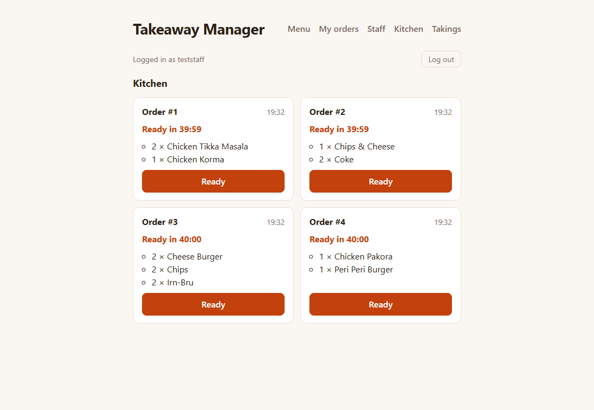
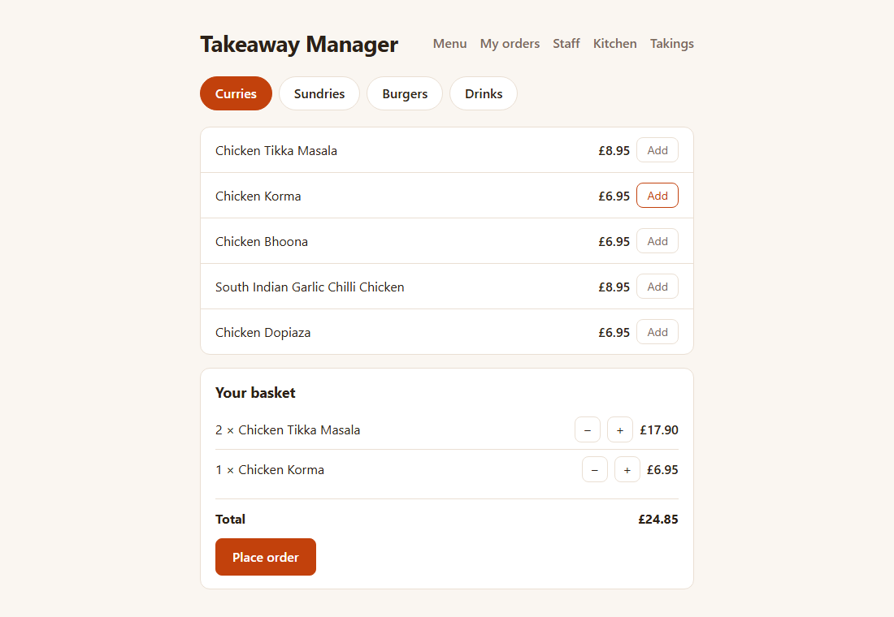
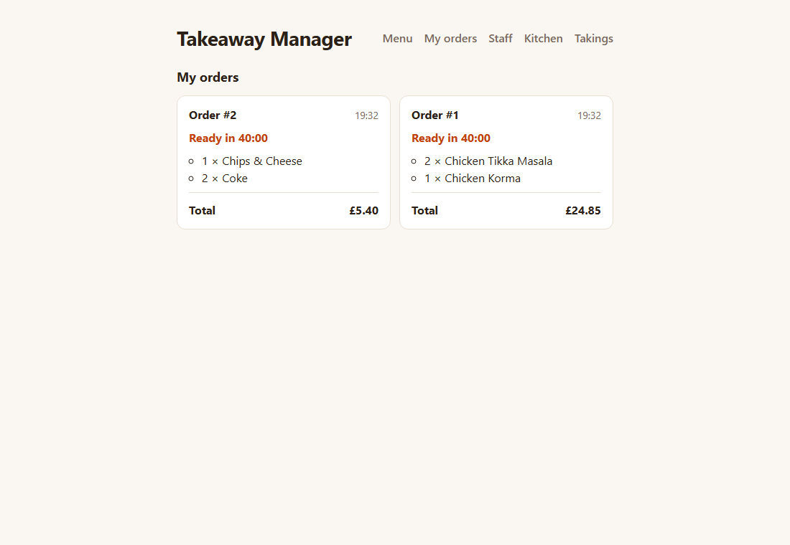
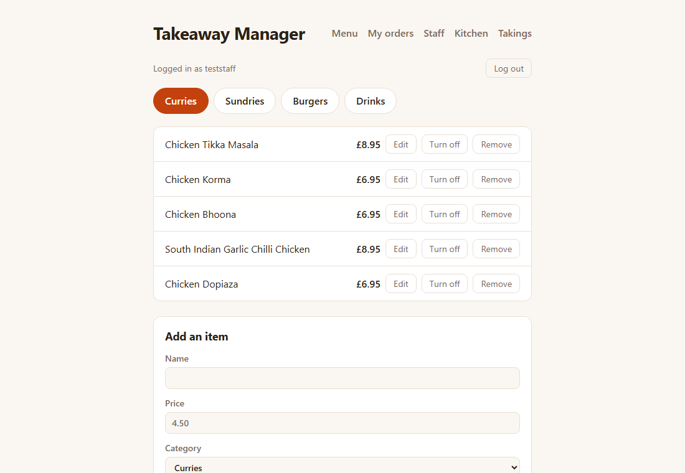
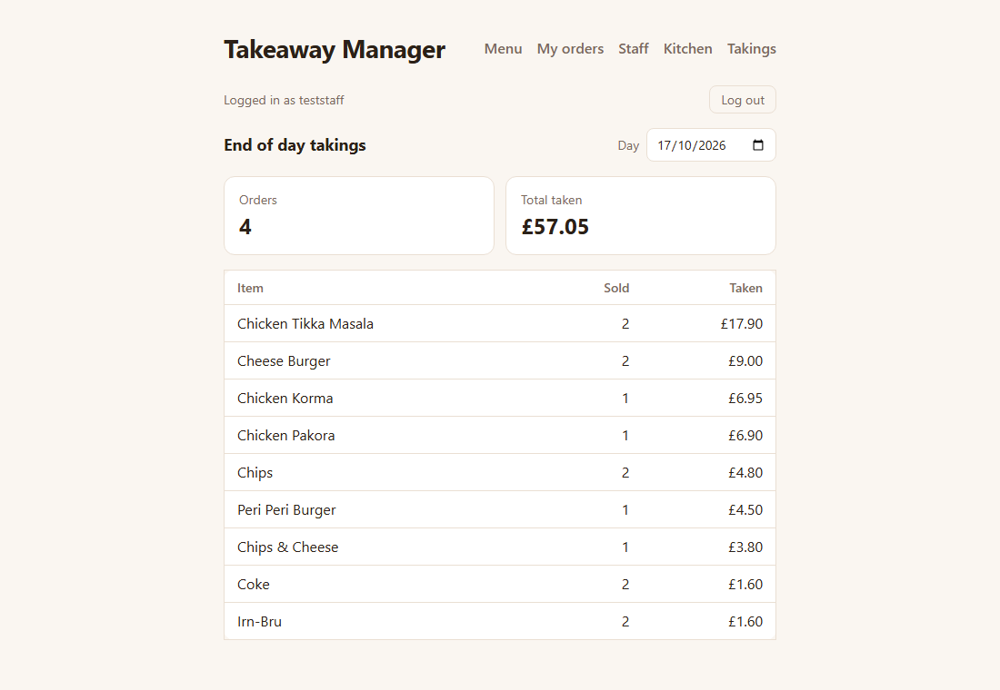

# Takeaway Manager


An ordering and sales app for a fast food takeaway, built from my eight months managing one.

**Live demo:** https://takeaway-manager.onrender.com

*Hosted on Render's free tier, so the first load can take about a minute while the server wakes up.*

**Try the staff side:** click **Staff** and log in with username `admin` and password `12345`. This is a demo login, so please be kind to the menu.



## Features

**For customers**
- Browse the menu by category and build a basket
- Place an order. Prices are always worked out by the server, never trusted from the browser.
- See your orders on **My orders**, with a countdown until each one is ready to collect

**For staff** (behind a login)
- **Menu:** add items, change prices, turn items off when they run out, and remove them
- **Kitchen screen:** waiting orders, oldest first, updating every few seconds. Mark an order ready, or it counts as ready after 40 minutes.
- **End of day takings:** number of orders, total taken, and how much of each item sold, for today or any earlier day

| Customer menu | My orders |
|---|---|
|  |  |

| Staff menu | End of day takings |
|---|---|
|  |  |

## Tech stack
- React + Vite
- Node.js + Express
- PostgreSQL
- Jest for unit tests, Playwright for browser tests
- GitHub Actions for CI
- Render for hosting

## Running it locally

You'll need [Node.js](https://nodejs.org/) 24 or newer and [PostgreSQL](https://www.postgresql.org/download/) 18.

1. Clone the repo and install the packages:

   ```bash
   git clone https://github.com/UmarAkhtar/Takeaway-Manager.git
   cd Takeaway-Manager
   npm install
   ```

2. Create two databases, `takeaway_dev` and `takeaway_test`. Then copy `.env.example` to `.env` and fill in your own values.

3. Set up the database, load the sample menu and create your staff login:

   ```bash
   npm run migrate
   npm run seed
   npm run create-staff
   ```

4. Start the server and the frontend together:

   ```bash
   npm run dev
   ```

5. Open [http://localhost:5173](http://localhost:5173) in your browser.

To run it the way it runs in production, as one server with no Vite:

```bash
npm run build
npm start
```

Then open [http://localhost:3000](http://localhost:3000).

## Running the tests

```bash
npm test
npm run test:e2e
```

`npm test` runs the unit tests. `npm run test:e2e` builds the app and runs the browser tests against `takeaway_test`, which is wiped and reseeded each time. Both run on every push and pull request through GitHub Actions.

## Deploying on Render

The live site runs as a Render web service with a Render PostgreSQL database.

- **Build command:** `npm ci --include=dev && npm run build`
- **Start command:** `npm run migrate && npm run create-staff && npm start`
- **Environment variables:** `DATABASE_URL` (the database's Internal URL), `NODE_ENV=production`, `STAFF_USERNAME`, `STAFF_PASSWORD`, `SESSION_SECRET`

Each deploy runs any new migrations and makes sure the staff login exists, but it never touches the menu or orders. The starting menu was loaded into the live database once, by running `npm run seed` from a local machine. Never seed the live database again, because it wipes the menu and all orders.

Render's free PostgreSQL database stops working 30 days after it's created and is deleted about two weeks after that, unless it's upgraded to a paid plan.

## What I would build next
- **Till mode:** a staff screen for taking orders at the counter, with big touch buttons and a cash or card choice. Takings would then split into cash and card, which is what gets checked against the drawer at closing.
- **Installable app:** let the till and kitchen screen run full screen on a tablet, like a real EPOS system
- **Printing:** send receipts and kitchen tickets straight to the shop's thermal printer, which also opens the cash drawer
- **Running in the shop:** a small PC in the back running the server and database, so orders keep working if the internet goes down
- **Card machine link:** connect to a card terminal so staff don't type the amount twice
